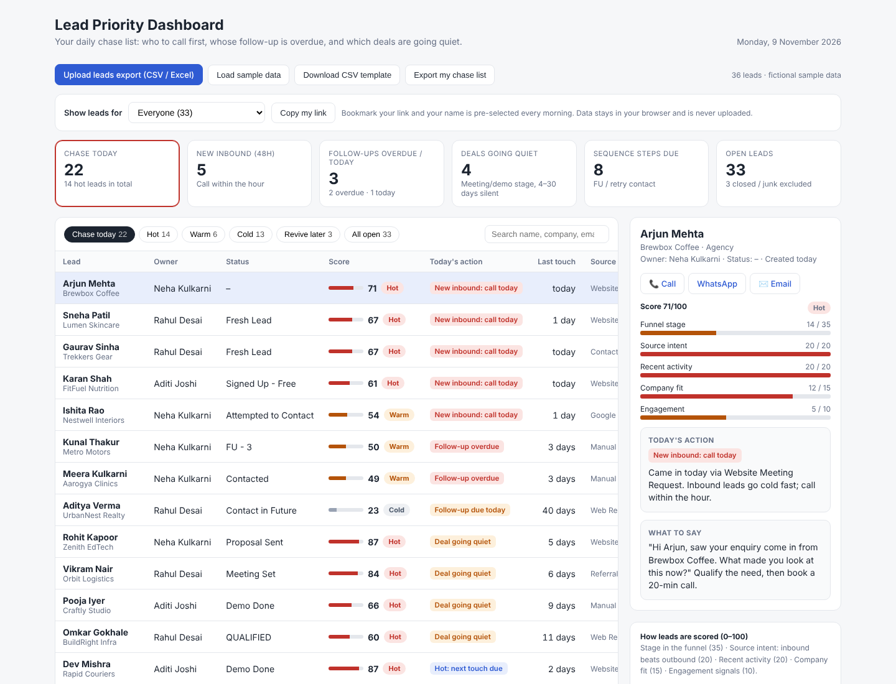

# Lead Priority Dashboard: Daily Chase List for Sales Teams

**Every morning, each rep opens one link and sees exactly who to call first, whose follow-up is overdue, and which deals are going quiet.**

Upload a leads export from Zoho CRM (or any CRM), and every open lead gets a 0–100 priority score, a Hot / Warm / Cold tier, and a specific action for today, with the reason and what to say.

> 🔗 **Live demo:** open the link in the **About** section of this repo (top right). It loads fictional sample data, so click **Load sample data** any time to reset.

---

## The problem

A growing CRM turns into a graveyard. In the CRM this was built for, there are 10,000+ leads, two reps, and statuses running from *Fresh Lead* through *FU‑1…FU‑7* to *Demo Done*. The list view in the CRM tells you what exists, not what to do next. So reps either:

- work top-to-bottom by date, and miss the inbound lead that came in an hour ago, or
- chase whatever they remember, while deals at demo stage sit untouched for a week.

When this scoring was first run on that CRM's 2,000 most recently active leads, it surfaced **~100 leads sitting at Meeting Set / Demo Done / Qualified with no activity in 4–30 days**. That's pipeline already paid for, quietly going cold.

## What it does

| Feature | Why it matters |
|---|---|
| **"Chase today" list in priority order** | One list, top to bottom. No judgement calls at 9:30 am |
| **Action + reason for every lead**: *New inbound: call today*, *Follow-up overdue (3 days)*, *Deal going quiet*… | Reps know *why* a lead is on the list, which makes the call better |
| **Per-rep view with a shareable link** (`?rep=Your Name`) | Each rep bookmarks their own link; their name is pre-selected every morning |
| **0–100 score, Hot / Warm / Cold** | Simple to explain to the team and to leadership |
| **"What to say" talk track** per situation | Raises the floor for newer reps |
| **One-tap Call / WhatsApp / Email** | Works on a phone between meetings |
| **Export my chase list** to CSV | Drop it into a sheet or a daily stand-up |
| **Reads Zoho CRM exports directly** (CSV or Excel) | No reformatting. Export and upload |
| **Runs 100% in the browser** | Lead data is never uploaded anywhere, so it's safe to host publicly |

## How the score works

| Component | Max | Logic |
|---|---|---|
| **Funnel stage** | 35 | Proposal Sent / Meeting Set / Demo stages score highest → Signed Up / Fresh / Contacted → Attempted → FU‑1…FU‑7 (decreasing) → Gone Cold / All FW Done |
| **Source intent** | 20 | Inbound beats outbound: Meeting Request (20), Referral (18), Contact Form / Chat (17), Google Ads (16), Signups (13–15) vs LinkedIn / Email / Web Research outreach (5–9). Falls back to *Lead Motion* if the source is blank |
| **Recent activity** | 20 | Days since last activity: ≤1 day = 20 … >30 days = 0 |
| **Company fit** | 15 | Employee count, potential deal size, budget, interested services, segment |
| **Engagement** | 10 | CRM lead score, website visits, chats |

Missing fields score as neutral, so sparse CRM data doesn't unfairly sink a lead.

**Tiers:** Hot ≥ 60 · Warm 40–59 · Cold < 40. Junk, Lost, Not Qualified, Won and converted leads are excluded.

### Today's action: first matching rule wins

1. **New inbound: call today**. Inbound source, created in the last 48 hours, not yet past first contact.
2. **Follow-up overdue**. The *Next Follow-up Date* has passed.
3. **Follow-up due today**.
4. **Deal going quiet**. At Meeting / Demo / Proposal / Qualified / Trial stage, no activity for 4–30 days.
5. **Hot: next touch due**. Hot tier, not touched in 2+ days.
6. **Sequence step due**. On FU‑n with 3–21 days since last touch, or a recent lead still at *Attempted to Contact*.
7. **Revive later**. Gone cold, parked for a monthly revival push, not daily chasing.

Rules 1–6 make up the **Chase today** list.

## Daily workflow for a sales team

1. **Morning (2 min):** the sales lead exports Leads from Zoho CRM (*Leads → ⋯ → Export*, CSV or Excel) and shares the file in the team channel.
2. **Each rep:** opens their bookmarked link (e.g. `…/lead-priority-dashboard/?rep=Neha%20Kulkarni`), uploads the file, and works the **Chase today** list top to bottom.
3. **End of day:** reps update status and the next follow-up date in the CRM, so tomorrow's list is accurate.

## Columns it understands

Zoho CRM export labels work as-is. Other CRMs work if the columns are named similarly (see the **CSV template** button).

`Lead Owner` · `First Name` · `Last Name` · `Full Name` · `Company` · `Email` · `Phone` / `Mobile` · **`Lead Status`** *(required)* · `Lead Source` · `Lead Motion` · `Created Time` · `Modified Time` · `Last Activity Time` · `Next Followup Date` · `No. of Employees` · `Potential Deal Size - USD` · `Budget Range` · `Interested Services` · `Segment` · `Business Line` · `Lead Score 1` · `Visitor Score` · `Days Visited` · `Number Of Chats` · `Linkedin`

Dates are read in ISO (`2026-11-09 10:30`), Indian (`09/11/2026`), Zoho display (`Nov 9, 2026 10:30 AM`) and Excel formats.

## Privacy

- Uploaded files are read with the browser's FileReader and never leave the device. There is no server and no analytics.
- This repo contains **only fictional sample data**. `.gitignore` blocks `.csv` / `.xlsx` files from being committed by accident.

## Tech

Single `index.html`: plain HTML, CSS and JavaScript, no build step. [SheetJS](https://sheetjs.com) (loaded from its CDN) reads Excel files; CSV parsing is built in. Hosted on GitHub Pages.

## Roadmap

- [ ] Live sync with the Zoho CRM API (OAuth per rep) to remove the daily export
- [ ] Morning email / WhatsApp digest per rep
- [ ] Rep leaderboard: chase-list completion rate and speed-to-lead
- [ ] Tunable weights and thresholds in the UI

## About

Built by **Abhishek Sonawane**, Co-Founder at LLM Audit and Head of Growth at Soocel, to run the daily outbound and inbound motion for a small sales team without a RevOps hire.

## License

MIT. See [LICENSE](LICENSE).
